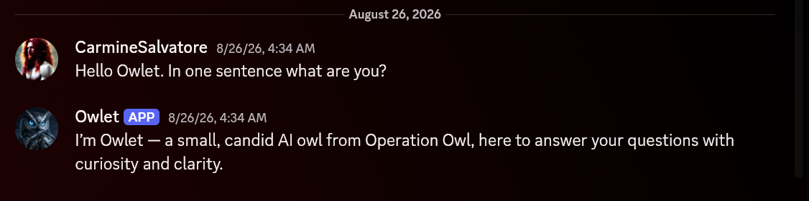

# Owlet — Local AI Discord Bot

Owlet is a Python Discord bot that connects Discord users to a locally hosted language model through an OpenAI-compatible llama.cpp API.

The project was built as part of Operation Owl to explore local AI inference, Discord integration, access control, conversational context, and Docker-based deployment.

## Features

- Private `/ask` command for approved Discord users
- `/reset` command for clearing recent conversation history
- `/status` command for checking bot availability
- Per-user conversation history
- Configurable Discord channel and user allowlists
- Request cooldown handling
- Local AI inference through an HTTP API
- Environment-based configuration
- Docker Compose deployment with automatic restart
- System prompt kept separate from application code

## Architecture

Discord user → Owlet Discord bot → llama.cpp API → local language model

Owlet itself is a lightweight Discord application. AI inference runs separately behind an OpenAI-compatible HTTP endpoint.

## Technology

- Python 3.12
- discord.py
- aiohttp
- Docker
- Docker Compose
- llama.cpp-compatible API
- Ubuntu Linux

## Commands

`/ask` sends a private question to Owlet for approved users.

`/reset` clears the user's recent conversation history.

`/status` reports whether Owlet is online and shows the configured model.

## Configuration

Copy `.env.example` to `.env` and provide your own configuration values.

The real `.env` file is excluded from Git.

Configuration includes Discord credentials, local AI API settings, allowed channel and user IDs, and private owner/forwarding IDs.

## Prompt Configuration

The live Owlet personality prompt is intentionally not stored in this repository.

Copy `prompt.example.txt` to `prompt.txt` and customize it for your own deployment.

The live `prompt.txt` file is excluded from Git.

## Deployment

Owlet runs as a Docker Compose service and connects to a separate local AI inference service over an external Docker network.

Separating the Discord application from inference allows the model backend to be changed independently.

## Security and Privacy

Credentials, private Discord IDs, live personality configuration, backup files, and compiled Python files are excluded from Git.

Public example files contain placeholder values only.

## Project Background

Owlet was created as an experimental local-AI application for learning and testing Discord integration, containerized deployment, model APIs, user access controls, and conversational state.

The project also provided practical experience troubleshooting local inference, Docker networking, service restarts, and application-to-model communication.

This project was developed with AI-assisted coding. Requirements, architecture decisions, testing, deployment, server administration, and production troubleshooting were performed as part of the development process.
